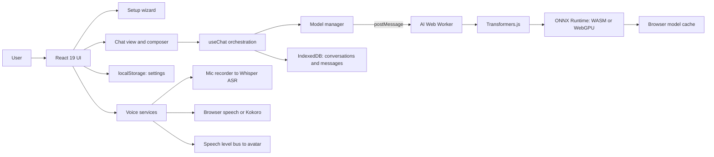
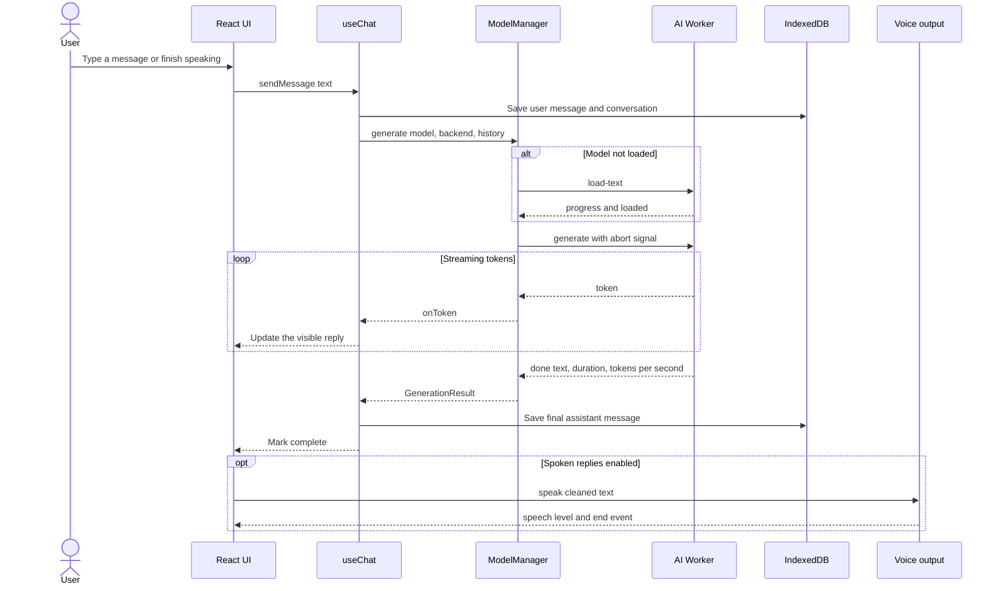
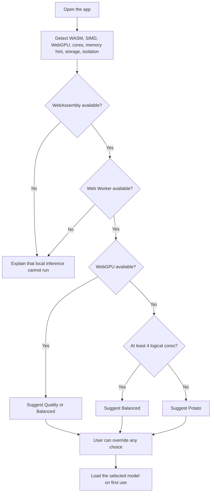
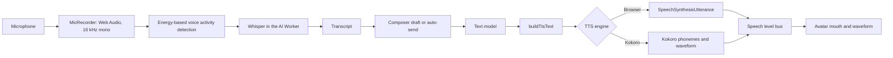

# Browser AI

A private, adaptive, voice-enabled AI companion that runs **entirely in your browser**.

Browser AI pairs a small language model with local speech recognition, speech synthesis, and an animated animal companion. There is no application backend, no account, and no paid API. Conversations are stored in IndexedDB on your device, and model inference happens in a Web Worker through [Transformers.js](https://github.com/huggingface/transformers.js) and ONNX Runtime Web (WebAssembly or WebGPU).

> **Disclaimer:** this is a demonstration of local inference, not a search engine or a professional advisor. Small models can be incomplete, biased, or simply wrong. Verify important information and do not use replies for medical, legal, financial, or safety-critical decisions.

---

## Features

- **Guided first-run setup** — device check, performance mode, companion, and voice preferences. No model is downloaded on page open.
- **Adaptive modes** — Potato, Balanced (default), Quality, and Custom, with real feature detection and manual overrides.
- **Local text generation** — LaMini-Flan-T5, SmolLM2, and Qwen2.5 checkpoints running on CPU/WASM or WebGPU.
- **Streaming output** — true token streaming when the runtime supports it, plus a presentation streamer and a stop button that cancels the worker request.
- **Voice input** — local Whisper Tiny/Base transcription through the microphone, with push-to-talk and auto-conversation modes.
- **Voice output** — browser `SpeechSynthesis` by default, optional Kokoro 82M neural TTS with automatic fallback.
- **Animated companions** — nine original SVG animals with idle, listening, thinking, speaking, happy, and error states. Mouth motion is driven by audio level and word-boundary timing, not phoneme-level lip sync.
- **Persistent chat** — conversations in IndexedDB, settings in `localStorage`, searchable history, rename, delete, and context management.
- **Private by design** — no analytics, no telemetry, no application server. Model files download directly from Hugging Face on first use.
- **Responsive, accessible UI** — dark/light/system themes, reduced-motion support, keyboard navigation, focus trapping, and mobile layouts.

---

## Quick start

```bash
npm install
npm run dev
```

Then open the printed local URL. The setup wizard appears first. The first message downloads the selected text model once; later visits reuse the browser cache.

### Requirements

- Node.js 20 or newer
- A current Chromium, Firefox, or Safari browser
- WebAssembly support (required)
- WebGPU (optional, improves speed on supported devices)
- A microphone for voice input (optional)

---

## Architecture



The main thread never runs model inference. A single worker owns text, ASR, and TTS pipelines and evicts least-recently-used models when the mode's memory budget is reached.

---

## Conversation lifecycle



Cancellation is propagated from the stop button through `AbortSignal` to the worker. A generation counter and a `finalized` flag prevent late tokens or late speech callbacks from mutating a newer conversation.

---

## Device compatibility



Detection is intentionally approximate:

- `navigator.deviceMemory` is unavailable in Firefox and reports a capped value in Chromium.
- WebGPU adapter details are often hidden for privacy.
- Multithreaded WASM requires cross-origin isolation. GitHub Pages cannot send COOP/COEP headers, so the app defaults to one thread there.
- The app never claims an exact RAM or GPU capability. It only offers guidance.

### Device profiles

| Profile | Example signals | Suggested mode | Typical experience |
| --- | --- | --- | --- |
| Unsupported | No WebAssembly or no Web Worker | — | Local inference cannot run |
| Low | 1–2 cores, ≤ 2 GB memory hint, no WebGPU | Potato | Slow CPU replies, browser voice |
| Standard | 4+ cores, 4–8 GB, no WebGPU | Balanced | Usable CPU replies, browser voice |
| High | 8+ cores, 8+ GB, WebGPU | Quality | Faster WebGPU inference, optional Kokoro |

---

## Performance modes

| Mode | Text model | Default backend | Memory budget | Voice |
| --- | --- | --- | --- | --- |
| Potato | LaMini-Flan-T5-77M | WASM | 1 pipeline | Browser |
| Balanced | LaMini-Flan-T5-248M | Auto | 2 pipelines | Browser |
| Quality | SmolLM2-360M-Instruct | Auto | 3 pipelines | Kokoro, browser fallback |
| Custom | Your choice | Your choice | 2–3 pipelines | Your choice |

Models are loaded lazily and evicted with an LRU policy. Potato mode never keeps text, ASR, and TTS pipelines in memory at the same time.

---

## Models

Only ONNX checkpoints published for Transformers.js are listed. Sizes are approximate quantized download sizes and may change when upstream repositories are updated.

### Text generation

| Model | Size | License | Backends | Notes |
| --- | --- | --- | --- | --- |
| `Xenova/LaMini-Flan-T5-77M` | ~96 MB | CC-BY-NC-4.0 | WASM | Smallest option; non-commercial |
| `Xenova/LaMini-Flan-T5-248M` | ~276 MB / ~225 MB WebGPU | CC-BY-NC-4.0 | WASM, WebGPU | Balanced default; non-commercial |
| `HuggingFaceTB/SmolLM2-360M-Instruct` | ~365 MB / ~273 MB WebGPU | Apache-2.0 | WASM, WebGPU | Chat-tuned, English-focused |
| `onnx-community/Qwen2.5-0.5B-Instruct` | ~512 MB / ~483 MB WebGPU | Apache-2.0 | WASM, WebGPU | Multilingual including Hindi |

### Speech recognition

| Model | Size | License | Notes |
| --- | --- | --- | --- |
| `Xenova/whisper-tiny` | ~41 MB | Apache-2.0 | Multilingual default |
| `Xenova/whisper-tiny.en` | ~41 MB | Apache-2.0 | English-only |
| `Xenova/whisper-base` | ~77 MB | Apache-2.0 | More accurate, slower |

Audio is resampled to 16 kHz mono in the browser. It is never uploaded.

### Speech synthesis

| Model | Size | License | Notes |
| --- | --- | --- | --- |
| Browser `SpeechSynthesis` | 0 MB | Browser-provided | Default, works offline |
| `onnx-community/Kokoro-82M-v1.0-ONNX` | ~92 MB WASM / ~163 MB WebGPU | Apache-2.0 | English neural voice, optional |

Kokoro is implemented directly with `AutoTokenizer`, `StyleTextToSpeech2Model`, and local English phonemization. Hindi replies fall back to the browser voice.

> **Licensing:** LaMini checkpoints are **CC-BY-NC-4.0** and may not be used commercially. SmolLM2, Qwen2.5, Whisper, and Kokoro are Apache-2.0. Review each model card before deploying this app commercially.

---

## Voice pipeline



### Interaction modes

- **Text only** — no microphone and no spoken replies.
- **Push to talk** — hold the microphone button, release to transcribe.
- **Auto conversation** — speak, pause, and the assistant replies aloud, then listens again. This mode enables automatic transcript submission and spoken replies.

Word-boundary events from `SpeechSynthesis` are used as an approximate mouth pulse. Kokoro playback uses an `AnalyserNode` for amplitude. The avatar does **not** claim phoneme-accurate lip sync.

---

## Companion states

| State | Trigger | Visual |
| --- | --- | --- |
| Idle | Nothing active | Gentle breathing, blinking, tail sway |
| Listening | Microphone recording | Perked ears, wide eyes, input waveform |
| Thinking | Model loading, generating, or transcribing | Head tilt, thought dots |
| Speaking | TTS playback or synthesis | Mouth motion from audio level, waves |
| Happy | Reply completed | Closed happy eyes, sparkles |
| Error | Generation, model, or microphone failure | Worried brows, sweat drop |

All nine animals are original inline SVG components: cat, fox, panda, rabbit, dog, bear, penguin, owl, and hamster. Reduced-motion mode pauses decorative animation.

---

## Privacy and storage

| Data | Location | Cleared by |
| --- | --- | --- |
| Conversations and messages | IndexedDB (`browser-ai`) | Delete conversations, reset app data, clear site data |
| Settings | `localStorage` (`browser-ai:settings:v2`) | Reset settings, clear site data |
| Model files | Browser Cache Storage, managed by Transformers.js | Clear model cache, clear site data |
| Voice recordings | Memory only | Discarded after transcription |

If IndexedDB is unavailable, the app falls back to an in-memory store and warns that history will be lost on reload.

There is no application backend. The only network requests are model and voice downloads from Hugging Face, plus whatever your browser does to fetch the static app itself.

---

## Project structure

```text
src/
  ai/
    generation/promptBuilder.ts    T5 and chat prompt construction, output cleaning
    models/modelRegistry.ts        Verified model metadata and defaults
    models/modelCompatibility.ts   Device scoring and backend resolution
    models/modelManager.ts         Worker lifecycle, progress, cancellation
    worker/aiWorker.ts             Text, ASR, and Kokoro inference in a worker
    worker/protocol.ts             Typed worker messages
  components/
    avatar/                        Nine SVG animals and speech-level animation
    chat/                          Messages, markdown, composer
    layout/                        Sidebar and header
    settings/                      Tabbed settings modal
    setup/                         First-run wizard
    ui/                            Buttons, modal, toasts, progress, icons
  hooks/
    useChat.ts                     Conversation state, streaming, persistence
    useSettings.ts                 Settings, theme, device detection
    useTTS.ts                      Speech output state
    useVoiceInput.ts               Microphone and ASR state
    useModelStatus.ts              Worker model status
  services/
    audio/                         Mic recorder, TTS, speech level bus
    device/                        Browser capability detection
    storage/                       IndexedDB and localStorage
  types/                           Shared TypeScript types
  App.tsx                          Application orchestration
  index.css                        Theme, layout, animations
scripts/
  copy-ort-assets.mjs              Copies ONNX Runtime WASM into public/ort
```

`public/ort` is generated at dev/build time and is gitignored. Model weights are never committed.

---

## Commands

```bash
npm install        # Install dependencies
npm run dev        # Start the Vite dev server
npm run typecheck  # TypeScript project build check
npm run lint       # Oxlint
npm test           # Vitest unit tests
npm run build      # Typecheck and production build
npm run preview    # Preview the production build
```

### Tests

The unit suite covers pure logic that does not need a browser:

- prompt construction and output cleaning
- TTS text cleanup
- device assessment and backend resolution
- model compatibility warnings
- settings normalization, clamping, and mode presets

Browser-only paths (model download, WebGPU, microphone, speech synthesis) require manual testing in a real browser.

---

## Deploying to GitHub Pages

The workflow at `.github/workflows/deploy.yml` builds the app and publishes `dist/`.

1. Push the repository to GitHub on the `main` branch.
2. Open **Settings → Pages**.
3. Under **Build and deployment → Source**, choose **GitHub Actions**.
4. Run the workflow or push a commit. The site will be published at
   `https://<user>.github.io/<repository>/`.

`vite.config.ts` uses `base: './'`, so assets work both at a domain root and under a repository sub-path.

GitHub Pages cannot set `Cross-Origin-Opener-Policy` or `Cross-Origin-Embedder-Policy`, so multithreaded WASM is unavailable there. The app detects this and uses a single thread. For multithreaded inference, serve the build from a host that sends those headers.

### Local production preview

```bash
npm run build
npm run preview
```

---

## Known limitations

- **Small models are limited.** LaMini can repeat itself and forgets older turns. SmolLM2 and Qwen are better but still far from large hosted models. Prompting reduces, but does not eliminate, hallucinated or role-played dialogue; malformed replies are detected and retried or replaced with a transparent fallback.
- **First load is heavy.** The balanced model is roughly 276 MB. Slow connections may take minutes.
- **WebGPU support varies.** Some adapters fail at runtime; the worker retries on CPU/WASM and reports the fallback.
- **Browser voices vary by operating system.** Some are network-backed, some are local, and availability can change after page load.
- **Kokoro is English-only here.** Hindi and other languages use browser speech.
- **Whisper accuracy drops** with background noise, strong accents, and short utterances.
- **Detection is approximate.** The app cannot know exact RAM or GPU limits.
- **No cross-device sync.** History belongs to one browser profile.
- **No model integrity pinning.** Model files are fetched from Hugging Face at the revisions resolved by Transformers.js.
- **Pages deployment is single-threaded** because of missing cross-origin isolation headers.
- **Browser-only paths are not unit-tested.** They were implemented against documented APIs and manual checks, not an automated browser suite.

---

## License

The application code is released under the [MIT License](./LICENSE).

Model weights keep their own licenses. In particular, LaMini models are **CC-BY-NC-4.0** and are not suitable for commercial use without permission. See [Models](#models) and each Hugging Face model card.
